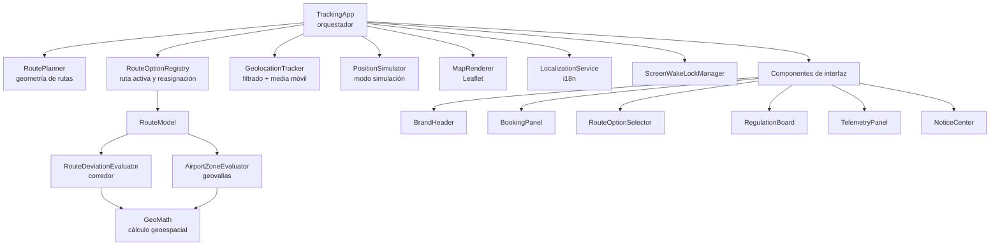

# Real-time route tracking — MVP (recogida de vehículos, PMI)

Aplicación web de **autoseguimiento de ruta** en un único archivo (`index.html`). Cada sesión
se ve a sí misma sobre la ruta activa: no hay backend, no hay base de datos y no se observan
otros vehículos.

Caso aplicado: **Terminal de llegadas del aeropuerto de Palma (PMI) → punto de recogida de
vehículos de alquiler**, con tres opciones de ruta, zonificación aeroportuaria, reglamentos
contextuales y consola en cuatro idiomas.

- **Sin build**: no hay `package.json`, ni bundler, ni paso de compilación.
- **Sin framework**: JavaScript y CSS nativos.
- **Un solo archivo**: ~4.000 líneas entre marcado, estilos y lógica.

---

## Tabla de contenidos

- [Inicio rápido](#inicio-rápido)
- [Qué hace](#qué-hace)
- [Arquitectura](#arquitectura)
- [Estados de seguimiento](#estados-de-seguimiento)
- [Layout responsive](#layout-responsive)
- [Configuración](#configuración)
- [Internacionalización](#internacionalización)
- [Datos de demostración](#datos-de-demostración)
- [Accesibilidad](#accesibilidad)
- [Cómo probar](#cómo-probar)
- [Restricciones conocidas](#restricciones-conocidas)
- [Camino a producción](#camino-a-producción)
- [Marca y contenido legal](#marca-y-contenido-legal)

---

## Inicio rápido

Abrir `index.html` directamente en el navegador funciona para **todo salvo la geolocalización
real**: `file://` no es contexto seguro, así que la aplicación detecta el bloqueo y arranca en
modo simulación por su cuenta, avisando en pantalla.

Para probar la geolocalización real hace falta `https` o `localhost`:

```bash
npx --yes serve .
```

Y luego abrir `http://localhost:3000`. Cualquier servidor estático sirve igual:

```bash
npx --yes http-server . -p 4321 -c-1
```

> **Requiere red la primera vez.** Leaflet y las teselas de OpenStreetMap se cargan desde
> unpkg y desde los servidores de OSM. Para uso 100 % offline, ver
> [Camino a producción](#camino-a-producción).

---

## Qué hace

### Tres opciones de ruta con cambio automático

Las rutas se calculan al arrancar mediante OSRM, a partir de un origen y un destino fijos más
los puntos de paso de cada opción. La activa se dibuja en verde; las demás en gris
discontinuo. Se eligen desde el panel lateral o pinchando la traza en el mapa.

Lo interesante es la **reasignación automática**: en cada lectura de posición, si el vehículo
ha salido del corredor de la ruta activa pero está dentro del corredor de otra opción, la
consola cambia la ruta activa sola y lo anuncia. Si no encaja en ninguna, mantiene el estado
de desvío. La lógica vive en `RouteOptionRegistry.findBetterMatchingModel()`.

### Zonificación aeroportuaria por geovallas

Cada reglamento puede llevar un `polygon`, que lo convierte en geovalla. Al entrar, su ficha
se resalta en el panel y se desplaza a la vista, y la zona se anuncia en el mapa. Hay tres
niveles de exigencia (`enforcement`):

| Nivel        | Efecto                                                              |
| ------------ | ------------------------------------------------------------------- |
| `prohibited` | Estado rojo, aviso de alerta. Cuenta como infracción.               |
| `regulated`  | Se anuncia la zona y se resalta su reglamento, sin marcar infracción. |
| `route`      | Norma aplicable a todo el recorrido, sin geovalla asociada.          |

### Filtrado y suavizado de la señal GPS

`GeolocationTracker` no pasa las lecturas en crudo:

1. Descarta las que tengan `accuracy` peor que `accuracyThresholdMeters`.
2. Aplica una media móvil sobre las últimas `movingAverageWindow` posiciones.
3. Deriva la velocidad de la distancia entre lecturas suavizadas, conservando la última
   velocidad conocida cuando no puede recalcularla.

### Modo simulación

Recorre la polilínea de la ruta activa a `simulationSpeedKmh`, emitiendo una posición cada
`simulationEmitIntervalMs`. Se activa a mano con el botón de la consola, y **automáticamente**
si la geolocalización no está disponible, se deniega o el navegador no la soporta.

### Cuatro idiomas

Español, English, Deutsch y Français, con selector en la cabecera. Se traduce toda la
interfaz: reglamentos, recomendaciones, nombres de ruta, zonas, avisos y etiquetas del mapa.
La preferencia se guarda en `localStorage` y sobrevive a la recarga.

### Otros detalles

- **Screen Wake Lock** mientras se hace seguimiento, para que la pantalla no se apague.
- **Encuadre automático** del vehículo, que se desactiva solo en cuanto el usuario mueve el
  mapa a mano (y se puede volver a activar con el botón *Seguir*).
- **Respeto por `prefers-reduced-motion`**: el pulso del marcador y las transiciones se
  desactivan.

---

## Arquitectura

Todo el JavaScript vive en dos bloques `<script>` al final de `index.html`. La composición se
hace en `TrackingApp`, que instancia el resto y conecta los eventos.



### Responsabilidades

| Clase                     | Responsabilidad                                                                                  |
| ------------------------- | ------------------------------------------------------------------------------------------------ |
| `TrackingApp`             | Compone el sistema, conecta eventos y decide cuándo publicar avisos.                             |
| `GeoMath`                 | Cálculo geoespacial a mano: distancia punto-polilínea, punto-en-polígono, longitud de traza.      |
| `RoutePlanner`            | Resuelve la geometría de cada opción: embebida, OSRM o línea recta de reserva.                   |
| `RouteModel`              | Una opción de ruta con su evaluador de corredor y su evaluador de zonas.                         |
| `RouteOptionRegistry`     | Mantiene la ruta activa y decide la reasignación automática.                                     |
| `RouteDeviationEvaluator` | Distancia al corredor y pertenencia a él.                                                        |
| `AirportZoneEvaluator`    | Resuelve en qué zona geovallada cae un punto.                                                     |
| `GeolocationTracker`      | `watchPosition`, descarte por precisión, media móvil, derivación de velocidad.                   |
| `PositionSimulator`       | Emite posiciones sintéticas recorriendo la polilínea activa.                                     |
| `MapRenderer`             | Todo el trato con Leaflet: capas, trazas, zonas, marcadores, encuadre.                           |
| `LocalizationService`     | Diccionarios, interpolación `{clave}`, persistencia, `Intl.NumberFormat`.                        |
| `RegulationBoard`         | Fichas de reglamentos y recomendaciones; resaltado de la zona activa.                            |
| `TelemetryPanel`          | Consola inferior: velocidad, distancia a ruta, estado y fuente de la geometría.                  |
| `NoticeCenter`            | Pila de avisos sobre el mapa, con tono `info` / `warning` / `alert`.                              |
| `ScreenWakeLockManager`   | Mantiene la pantalla encendida y reintenta al volver de segundo plano.                            |

### Flujo de una lectura de posición

```
watchPosition (o PositionSimulator)
  ↓  descarte por accuracy + media móvil
TrackingApp.consumeFix(fix)
  ↓  ¿otra ruta encaja mejor?  →  RouteOptionRegistry.findBetterMatchingModel()
  ↓  evaluar posición          →  RouteModel.evaluatePosition()  →  { state, distanceToRouteMeters, activeZone }
  ├→ MapRenderer      · mueve el marcador y aplica el color de estado
  ├→ TelemetryPanel   · velocidad, distancia a ruta, pill de estado
  ├→ RegulationBoard  · resalta la zona activa
  └→ NoticeCenter     · publica aviso solo si el estado o la zona han cambiado
```

El último punto importa: los avisos se emiten **por transición**, no por lectura. Sin eso, un
vehículo detenido fuera del corredor generaría un aviso por segundo.

### Origen de la geometría, intercambiable

`RoutePlanner` devuelve siempre `{ id, isRecommended, coordinates, source, distanceMeters,
durationSeconds }`, y `source` indica de dónde salió la traza:

| `source`            | Significado                                                       |
| ------------------- | ----------------------------------------------------------------- |
| `embedded`          | De `routeOptions[].precomputedPath`. No hay llamada de red.        |
| `routing-service`   | De OSRM.                                                          |
| `straight-fallback` | OSRM falló o dio una geometría inservible: línea recta origen→destino. |

Se puede sustituir el proveedor de rutas sin tocar nada más, siempre que respete ese contrato.
La fuente activa se muestra en la consola.

---

## Estados de seguimiento

| Estado             | Condición                                              | Color     |
| ------------------ | ------------------------------------------------------ | --------- |
| En ruta            | distancia a la polilínea activa ≤ `corridorMeters`     | `#00843D` |
| Fuera del corredor | distancia > `corridorMeters`                           | `#B36A00` |
| Zona restringida   | el punto cae dentro de una zona `prohibited`           | `#B3261E` |
| Desconocido        | todavía no hay ninguna lectura válida                  | gris      |

La zona restringida tiene prioridad sobre el corredor: estar dentro de una zona `prohibited`
marca rojo aunque se vaya por la ruta correcta.

> **Nota sobre la demo:** el estado rojo está implementado y probado, pero **ninguna zona de la
> configuración actual usa `enforcement: "prohibited"`** — las cuatro geovalladas son
> `regulated`. Para verlo en acción hay que añadir una zona `prohibited` a
> `routeConfiguration.regulations` (ver [Datos de demostración](#datos-de-demostración)).

La distancia punto-a-polilínea (proyección local a metros + punto-a-segmento) y el
punto-en-polígono (*ray casting*) están implementados a mano en `GeoMath`, sin librería
geoespacial.

---

## Layout responsive

La aplicación usa **dos modelos de layout distintos**, no uno estirado. Ese es el punto de
diseño más importante del CSS y conviene entenderlo antes de tocarlo.

### ≥ 981 px — *app-shell*

`body` es una rejilla de tres filas a `100dvh` con `overflow: hidden`. **El documento no
scrollea.** El mapa y la ficha comparten la fila central, y la ficha scrollea por dentro.

```
┌───────────────────────────────────────────┐
│ cabecera                                  │  auto
├─────────────────────────────┬─────────────┤
│                             │ ficha       │
│ mapa                        │ (scroll     │  1fr
│                             │  interno)   │
├─────────────────────────────┴─────────────┤
│ consola                                   │  auto
└───────────────────────────────────────────┘
```

| Ancho           | Columna de la ficha |
| --------------- | ------------------- |
| ≥ 1400 px       | 420 px              |
| 1200 – 1399 px  | 380 px              |
| 981 – 1199 px   | 330 px              |

### ≤ 980 px — el documento manda

Se **abandona** el *app-shell*: el documento scrollea con naturalidad y la ficha fluye
completa, sin `max-height` ni scroll interno, de modo que ningún módulo pueda quedar
recortado. Las barras se fijan con `position: sticky`.

```
┌───────────────────────────────────────────┐
│ cabecera            ← sticky top          │
├───────────────────────────────────────────┤
│ mapa   40–44svh, mín. 240px, máx. 440px   │
├───────────────────────────────────────────┤
│ ficha  (fluye completa, sin recorte)      │
│   · Reserva                               │   scroll del
│   · Opciones de ruta   ← carrusel         │   documento
│   · Reglamentos                           │
│   · Recomendaciones                       │
├───────────────────────────────────────────┤
│ consola             ← sticky bottom       │
└───────────────────────────────────────────┘
```

Decisiones concretas:

- **La consola es `sticky`, no `fixed`.** Así conserva su hueco en el flujo y el último módulo
  de la ficha nunca queda tapado.
- **La cabecera se recompone con `grid-template-areas`** en dos filas (marca + idioma / ruta +
  estado), pasando de 136 px a 99 px sin perder nada.
- **Dentro de la consola se invierte el orden** con `order`: primero las acciones, después la
  telemetría. En una barra de acción persistente lo accionable va arriba.
- **Los avisos se anclan abajo del mapa** (patrón *snackbar*), donde no chocan con el control
  de zoom de Leaflet.
- **Los títulos de sección dejan de ser `sticky`**: con scroll de documento solo producirían
  solapes contra la cabecera fija.

Ajustes por tramo:

| Tramo         | Particularidad                                                      |
| ------------- | ------------------------------------------------------------------- |
| 768 – 980 px  | La ficha pasa a **dos columnas**; la tarjeta de reserva ocupa el ancho completo. |
| ≤ 767 px      | Opciones de ruta en **carrusel horizontal** con `scroll-snap`.        |
| ≤ 560 px      | Mapa a `40svh`; la rejilla de la reserva pasa a una columna.          |
| ≤ 400 px      | Se oculta la fuente de la ruta, que no cabe junto a los dos botones. |

### Variables de layout

| Variable           | Uso                                                               |
| ------------------ | ----------------------------------------------------------------- |
| `--appbar-height`  | Altura mínima de la cabecera en escritorio (62 px).               |
| `--console-height` | Altura mínima de la consola en escritorio (84 px).                |
| `--gutter`         | Margen lateral base (18 px).                                      |
| `--radius`         | Radio de esquina de las tarjetas (10 px).                         |

> **Cuidado al reintroducir `calc()` con estas variables.** Una versión anterior calculaba la
> altura de la ficha como `calc(100dvh - var(--appbar-height) - var(--console-height))`. En
> móvil la consola real medía 259 px frente a los 84 px declarados, así que el cálculo se
> desviaba ~175 px y la ficha se quedaba con 43 px útiles para 2.438 px de contenido: las
> opciones de ruta, los reglamentos y las recomendaciones eran inalcanzables. El layout actual
> no depende de esas alturas en móvil, y por eso funciona. Si vuelves a acoplarlas, mide.

### Conmutador carrusel / lista

En móvil, las opciones de ruta se presentan como carrusel horizontal con un botón para pasar a
lista vertical. A partir de 768 px el conmutador se oculta y la lista vertical es el único
modo: un carrusel dentro de una columna de 380 px sería peor que la lista.

Detalle de implementación que conviene conocer: el marcado generado es
`<li><button class="option">…</button></li>`, así que **el flex item es el `<li>`**, no
`.option`. El ancho de tarjeta se fija en `.option-list > li` con `flex: 0 0 86%` — no con
`min-width`, que es solo un piso y dejaba crecer las tarjetas hasta su `max-content`. El 14 %
restante deja asomar la tarjeta siguiente, que es la señal visual de que la lista se desliza.

---

## Configuración

Todo se controla desde `routeConfiguration` y `localization`, al inicio del primer `<script>`.
No hay variables de entorno ni archivos de configuración externos.

### Ruta y geografía

| Campo                            | Uso                                                                    |
| -------------------------------- | ---------------------------------------------------------------------- |
| `origin`, `destination`          | Puntos fijos de la ruta, `[lat, lng]`.                                 |
| `routeOptions[]`                 | Opciones de ruta: `id`, `viaPoints`, `isRecommended`, `precomputedPath`. |
| `routeOptions[].viaPoints`       | Puntos de paso intermedios que definen la variante.                    |
| `routeOptions[].isRecommended`   | La primera marcada así es la ruta activa inicial.                      |
| `routeOptions[].precomputedPath` | Polilínea precalculada. Si tiene ≥ 2 puntos, esa opción **no llama a OSRM**. |
| `corridorMeters`                 | Semiancho del corredor para el estado "en ruta" (45 m).                |

### Señal GPS

| Campo                     | Uso                                                          |
| ------------------------- | ------------------------------------------------------------ |
| `accuracyThresholdMeters` | Lecturas con `accuracy` peor que esto se descartan (60 m).    |
| `movingAverageWindow`     | Tamaño de la media móvil sobre las últimas N posiciones (4).  |

### Reglamentos y contenido

| Campo                       | Uso                                                                        |
| --------------------------- | -------------------------------------------------------------------------- |
| `regulations[]`             | `code`, `icon`, `enforcement` y `polygon` opcional. Con `polygon` es geovalla. |
| `recommendations[]`         | Recomendaciones operativas (`code` + `icon`).                              |
| `booking`, `shuttleService` | Datos de la reserva y del servicio que se muestran en la tarjeta superior.  |
| `operator.logoImageDataUri` | Logotipo del operador como data URI. Si es `null`, glifo genérico.          |

### Servicio de rutas

| Campo                      | Uso                                                     |
| -------------------------- | ------------------------------------------------------- |
| `routingServiceBaseUrl`    | Base de OSRM (`https://router.project-osrm.org`).        |
| `routingRequestTimeoutMs`  | Tiempo máximo por petición antes de abortar (9.000 ms).  |

### Simulación y presentación

| Campo                       | Uso                                                     |
| --------------------------- | ------------------------------------------------------- |
| `simulationSpeedKmh`        | Velocidad del vehículo simulado (45 km/h).              |
| `simulationStepMeters`      | Paso de avance sobre la polilínea (4 m).                |
| `simulationEmitIntervalMs`  | Cadencia de emisión de posiciones (1.000 ms).           |
| `markerAnimationDurationMs` | Deslizamiento del marcador entre posiciones (900 ms).   |
| `vehicleFocusZoom`          | Nivel de zoom al encuadrar el vehículo (16).            |
| `tileLayerUrl`              | Plantilla de URL de las teselas.                        |
| `tileLayerAttribution`      | Texto de atribución del mapa. **No lo quites.**          |

---

## Internacionalización

`localization` contiene el catálogo completo:

```js
const localization = {
  defaultLanguageCode: "es",
  storageKey: "pmi-tracking-language",
  languages: [ { code: "es", label: "Español" }, /* en, de, fr */ ],
  dictionaries: { es: { /* … */ }, en: { /* … */ }, de: { /* … */ }, fr: { /* … */ } }
};
```

Cómo funciona:

- **Claves con ruta de puntos**: `translate("ui.section.regulations")` recorre el diccionario
  por niveles. Si la clave falta en el idioma activo, cae al idioma por defecto; si tampoco
  está, devuelve la propia clave (así los huecos se ven en pantalla en vez de romper).
- **Interpolación** con `{nombre}`: `translate("ui.option.count", { count: 3 })` sobre
  `"{count} opciones"`.
- **Marcado declarativo**: cualquier elemento con `data-i18n="ruta.de.la.clave"` se rellena
  solo al arrancar y en cada cambio de idioma.
- **Números** con `Intl.NumberFormat` según el idioma activo, así los decimales usan el
  separador correcto.
- **Contenido indexado por código**: los reglamentos, recomendaciones y opciones de ruta se
  traducen por su código, no por su posición:

```js
regulations: {
  "PMI-DAR-01": { zone: "Dársena de lanzaderas", title: "…", detail: "…" }
}
```

### Añadir un idioma

1. Añadir `{ code: "it", label: "Italiano" }` a `localization.languages`.
2. Añadir `it: { … }` a `dictionaries`, copiando la estructura de `es`.

No hace falta tocar nada más: el selector se construye a partir de `languages` y las claves
que falten caen al español.

---

## Datos de demostración

### Opciones de ruta

| Código         | Nombre                            | Nota                     |
| -------------- | --------------------------------- | ------------------------ |
| `OPT-DIRECT`   | Ruta directa aeropuerto           | Recomendada por defecto  |
| `OPT-COASTAL`  | Ruta litoral hacia Platja de Palma | Vía costa                |
| `OPT-RABASSA`  | Ruta por Son Sant Joan            | Vía perimetral           |

### Reglamentos activos

| Código       | Zona / Norma                                   | `enforcement` | Geovalla |
| ------------ | ---------------------------------------------- | ------------- | -------- |
| `PMI-DAR-01` | Dársena de lanzaderas                          | `regulated`   | Sí       |
| `PMI-PER-04` | Vial perimetral de servicio                    | `regulated`   | Sí       |
| `PMI-BUS-05` | Zona de transporte público                     | `regulated`   | Sí       |
| `PMI-OFI-06` | Zona de descenso en oficina                    | `regulated`   | Sí       |
| `PMI-SPD-07` | Límite de 30 km/h en viales del aeropuerto     | `route`       | No       |
| `PMI-PAX-08` | Cinturón abrochado y sin pasajeros de pie      | `route`       | No       |
| `PMI-PMR-09` | Prioridad de embarque para pasajeros PMR       | `route`       | No       |

Los tres últimos no llevan `polygon`: aplican a todo el recorrido y por eso su campo `zone`
está vacío en los diccionarios.

### Recomendaciones

| Código   | Recomendación                                                |
| -------- | ------------------------------------------------------------ |
| `REC-01` | Mantente dentro del corredor de 45 m                          |
| `REC-02` | Toma el carril derecho al salir de la terminal                 |
| `REC-03` | Detén el vehículo por completo antes de abrir puertas          |
| `REC-04` | Confirma el conteo de pasajeros y el equipaje asegurado        |
| `REC-05` | Llegadas 08:00–11:00: usa la ruta por Coll d'en Rabassa        |

> **Traducciones huérfanas.** Los diccionarios incluyen textos completos, en los cuatro
> idiomas, para `PMI-ZSR-02` (Zona de Seguridad Restringida) y `PMI-AIR-03` (Lado aire ·
> plataforma), pero esos códigos **no están en `routeConfiguration.regulations`**, así que no se renderizan ni
> geovallan. Son los candidatos naturales a `enforcement: "prohibited"`: para activar el estado
> rojo, basta añadirlos a la configuración con su polígono. Si no piensas usarlos, se pueden
> borrar de los cuatro diccionarios.

---

## Accesibilidad

Lo que ya está resuelto:

- **Estado por más de un canal**: los estados no dependen solo del color. Llevan etiqueta de
  texto en el pill de cabecera y en la consola.
- **Regiones en vivo**: el pill de estado es `role="status" aria-live="polite"`, y la pila de
  avisos también, así los cambios se anuncian sin robar el foco.
- **Foco visible** en todo lo interactivo, con `:focus-visible` y un anillo de 2 px.
- **Objetivos táctiles** de 44 px de alto mínimo en los botones de la consola en móvil
  (WCAG 2.5.5).
- **Estado de los conmutadores** expuesto con `aria-pressed`, no solo con estilo.
- **Opciones de ruta operables por teclado**: `role="button"`, `tabindex="0"` y activación con
  <kbd>Enter</kbd> / <kbd>Espacio</kbd>.
- **`prefers-reduced-motion`** desactiva el pulso del marcador y las transiciones.
- **`lang` del documento** se actualiza al cambiar de idioma, para que los lectores de pantalla
  cambien de voz.
- **Texto solo para lectores** (`.sr-only`) donde el icono no basta.

Pendiente y honesto:

- El contraste de los textos secundarios (`--ink-dim` sobre `--surface-alt`) no está auditado
  formalmente contra AA en todos los pares.
- El mapa es `role="application"` con etiqueta, pero **la ruta no es explorable por teclado**:
  un usuario que no vea el mapa no tiene equivalente textual del trazado.
- El carrusel de opciones no expone su posición ("2 de 3") a la tecnología asistiva.

---

## Cómo probar

### Recorrido funcional

1. Abrir la aplicación. Si la geolocalización no está disponible, debe aparecer un aviso y
   arrancar la simulación sola.
2. Pulsar **Iniciar simulación**. El marcador debe recorrer la ruta y la velocidad de la
   consola debe dejar de ser `—`.
3. Cambiar de opción de ruta desde el panel y pinchando la traza gris en el mapa. La activa
   pasa a verde y la simulación se recarga con la nueva polilínea.
4. Mover el mapa a mano: el botón **Seguir** debe desactivarse solo.
5. Cambiar de idioma: toda la interfaz debe traducirse, incluidos los reglamentos y los avisos
   ya visibles. Recargar y comprobar que el idioma persiste.
6. Dejar que la simulación entre en una zona geovallada: su ficha debe resaltarse y
   desplazarse a la vista, con aviso.

### Responsive

Con DevTools → *Responsive*, comprobar en 320, 390, 768, 1024 y 1400 px:

| Comprobación                                                        | Esperado                      |
| ------------------------------------------------------------------- | ----------------------------- |
| Scroll horizontal del documento                                     | Ninguno a ningún ancho        |
| Los cuatro módulos de la ficha son alcanzables                      | Sí, ninguno recortado         |
| Al final del scroll, el último módulo no queda bajo la consola      | Correcto                      |
| Cabecera y consola permanecen visibles durante todo el recorrido    | Sí (≤ 980 px)                 |
| En ≥ 981 px: cabecera + área central + consola = altura de ventana  | Exacto, sin scroll de documento |
| El carrusel de opciones desliza y encaja                            | Sí (≤ 767 px)                 |

Estas comprobaciones se pueden automatizar desde la consola del navegador. Por ejemplo, para
detectar cualquier módulo recortado:

```js
const ficha = document.querySelector('.briefing');
console.log('recorte:', ficha.scrollHeight - ficha.clientHeight); // debe ser 0 en móvil
```

Conviene además probar en **iOS Safari y Chrome Android reales**, no solo en el emulador: el
área segura (`env(safe-area-inset-*)`), las unidades `svh` y el comportamiento de las barras
del sistema no se reproducen fielmente en DevTools.

---

## Restricciones conocidas

1. **Sin seguimiento en segundo plano.** Al bloquear el teléfono o mandar la pestaña a
   background, el sistema operativo suspende los *timers* y corta la geolocalización. Es una
   limitación de la plataforma web, no del código. Mitigación en este MVP: Screen Wake Lock API
   mientras se hace seguimiento.

2. **OSRM público es un servidor de demostración**, con límites de uso y sin SLA. Cada carga
   hace una petición por opción de ruta (tres). **No usar en producción.**

3. **La geolocalización real exige contexto seguro** (`https` o `localhost`) y suele estar
   bloqueada dentro de iframes cross-origin. Si falla o se deniega, la simulación arranca sola
   y lo avisa.

4. **Las coordenadas de las zonas son aproximaciones** para la demo. Siguen la nomenclatura del
   zonificado aeroportuario (ZSR, lado aire, viales de servicio, transporte público, entrega de
   alquiler), pero deben sustituirse por la cartografía oficial de AENA antes de cualquier uso
   operativo. Los textos de los reglamentos son contenido de demostración, **no una publicación
   oficial** de ningún aeropuerto ni operador.

5. **Requiere red al arrancar** para Leaflet (unpkg) y las teselas de OSM.

6. **Al arrastrar sobre el mapa en móvil, el gesto lo captura Leaflet**, no la página. El scroll
   del documento funciona desde la ficha. Si resulta molesto en uso real, se resuelve con un
   patrón "toca para activar el mapa".

---

## Camino a producción

| Limitación                  | Solución                                                                                                                    |
| --------------------------- | --------------------------------------------------------------------------------------------------------------------------- |
| Seguimiento en background   | App nativa (.NET MAUI) con permisos de ubicación en segundo plano. La web no puede resolverlo.                               |
| Dependencia de OSRM público | Precalcular cada ruta una vez y embeberla en `precomputedPath` (queda 100 % local, sin red), o auto-hospedar OSRM / Valhalla. |
| Dependencia de unpkg        | Embeber `leaflet.js` y `leaflet.css` en el archivo o servirlos desde el propio dominio.                                      |
| Teselas de OSM              | Servicio de teselas con contrato de uso, o teselas propias. La política de uso de OSM no cubre producción.                    |
| Cartografía de zonas        | Sustituir los polígonos por la cartografía oficial de AENA.                                                                  |
| Textos de reglamentos       | Sustituir por la normativa real, con su referencia y fecha de publicación.                                                    |

Para el modo totalmente offline, la combinación es: `precomputedPath` en las tres opciones +
Leaflet embebido + teselas locales. En ese escenario la aplicación no hace ni una petición de
red.

---

## Marca y contenido legal

El distintivo del operador que se dibuja es un **glifo genérico de vehículo**, no el logotipo
registrado de ninguna compañía de alquiler. Para usar un asset oficial —con los derechos
correspondientes— colócalo en `routeConfiguration.operator.logoImageDataUri` como data URI.

Los nombres de operador, matrículas, referencias de reserva y textos de reglamentos son
**contenido de demostración inventado**. No representan datos reales ni publicaciones oficiales
de ningún aeropuerto, administración u operador de transporte.
